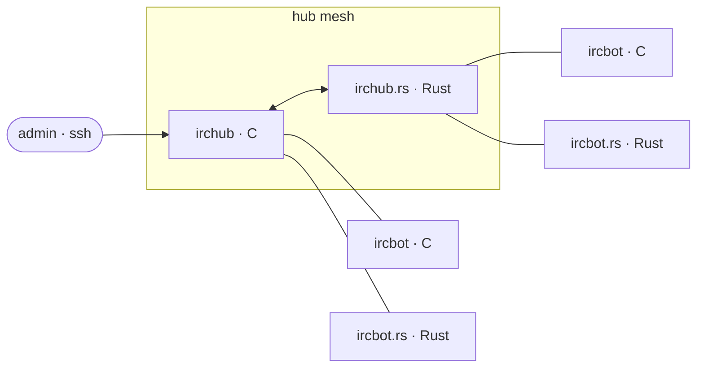

# ircbot.rs

An IRC bot in safe Rust (`#![forbid(unsafe_code)]`), a 1:1 port of [ircbot](https://github.com/robertclemens/ircbot). It keeps channels opped, guarded and in sync, takes commands from admins and opers who sign in with their own Curve25519 key, and gets its whole configuration from an [irchub](https://github.com/robertclemens/irchub) hub — or runs standalone. **Hub-managed with irchub (or irchub.rs) is the recommended setup.**

There are no admin, oper or bot passwords. Every bot, hub, admin and oper has its own keypair (Ed25519 signatures, X25519 encryption) and only public keys are exchanged. The one password left is the bot's config-file password.

## The family

Four interchangeable programs. Any bot works with any hub, and C and Rust hubs peer in one mesh.

| Project | Language | Role |
|---------|----------|------|
| [ircbot](https://github.com/robertclemens/ircbot) | C | IRC bot |
| **[ircbot.rs](https://github.com/robertclemens/ircbot.rs)** | Rust (no `unsafe`) | IRC bot, a 1:1 port of ircbot |
| [irchub](https://github.com/robertclemens/irchub) | C | Hub: config sync, mesh, SSH admin console |
| [irchub.rs](https://github.com/robertclemens/irchub.rs) | Rust (no `unsafe`) | Hub, a 1:1 port of irchub |



| | irchub (C) | irchub.rs (Rust) |
|---|:---:|:---:|
| **ircbot (C)** | ✅ | ✅ |
| **ircbot.rs (Rust)** | ✅ | ✅ |
| **peer hub: irchub / irchub.rs** | ✅ | ✅ |

Same wire protocol, same config files, same console. All four share version numbers. Use matching releases: a hub refuses bots and peers below its version floor.

## Demo

Three short recordings, each also as screenshots with every command ([all walkthroughs](demo/README.md)):

1. **[Set up two hubs, link them, add a bot](demo/setup.md)**
2. **[The hub console over SSH](demo/console.md)**: login, sample commands, full-screen view
3. **[Commanding a bot from irssi](demo/irssi.md)**

[](demo/setup.md)

## Requirements

- Rust 1.89+ (`cargo`, `rustc`): [rustup](https://rustup.rs), or your distribution's `cargo` if it is new enough
- No C compiler, OpenSSL or libcurl: crypto, TLS (the pure-Rust `graviola` provider) and HTTPS are Rust crates
- x86_64 or aarch64 with the CPU features `graviola` needs: on x86_64 aes, pclmulqdq, ssse3, avx, avx2, adx, bmi1, bmi2 (most chips since about 2014); on aarch64 aes, sha2, pmull, neon (Raspberry Pi 5 yes, Pi 4 no)

## Quick reference

```bash
# Build
git clone https://github.com/robertclemens/ircbot.rs.git && cd ircbot.rs
cargo build --release      # target/release/ircbot, keygen, bot-auth

# One directory per bot; config, pid and log live beside the binary
mkdir ~/bot1 && cp target/release/ircbot ~/bot1/ && cd ~/bot1
./ircbot -setup            # wizard: password, nick, mode; hubs (address + key from `irchub -id`) or an IRC server
./ircbot -id               # print the UUID + public key again (the hub's `bot add` line)

# Register it on a hub's console:  bot add bot1 <uuid> <pubkey>

./ircbot -p                # optional: machine-bound .ircbot.pass for unattended start
./ircbot                   # start (daemonizes; asks for the password if there is no .ircbot.pass)
kill $(cat .ircbot.pid)    # stop

# Optional keepalive, needs .ircbot.pass:  */5 * * * * /home/user/bot1/ircbot >/dev/null 2>&1
```

## Setup

1. **Set it up.** `./ircbot -setup` asks for a config password, the bot's nick and ident, and a mode:
   - **Hub-managed** (recommended): give each hub's `host:port` and public key. `./irchub -id` on the hub prints both. Admins, opers, channels and the IRC servers then come from the hub; the bot joins IRC after its first sync.
   - **Standalone**: give an IRC server, the first admin's public key and usermask, and a channel. Other standalone bots trust this one with `+bot <nick!user@host> <uuid> <pubkey>`.

   The bot makes its own keypair and prints its UUID and public key. Its private key never leaves the machine.
2. **Register it** (hub-managed): `bot add <nick> <uuid> <pubkey>` in the hub console.
3. **Start it**: `./ircbot`. Run one binary per bot, in a directory only you can write to.

## Commanding the bot

Each admin and oper makes a keypair (`target/release/keygen <name>`, or the hub's `keygen`) and gives the `.public.b64` to an admin, who adds them on the hub (`user add admin|oper …`). An IRC client script then signs in to the bot and seals every command:

| Client | Script in `utils/` |
|--------|--------------------|
| irssi | `ircbot_irssi_auth.pl` (needs CryptX) |
| HexChat | `ircbot_hexchat_auth.py` (needs python3-cryptography) |
| WeeChat | `ircbot_weechat_auth.py` (needs python3-cryptography) |
| command line, mIRC | `bot-auth` (`target/release/bot-auth`), `bot-auth.mrc` |

irssi example ([irssi walkthrough](demo/irssi.md) shows a real session):

```bash
mkdir -p ~/.irssi/scripts && cp utils/ircbot_irssi_auth.pl ~/.irssi/scripts/   # or scripts/autorun/ to load on start
```
```
/script load ircbot_irssi_auth.pl
/set bot_auth_keyfile /home/user/admin/20261121120000_admin.private.b64   (full path, no ~)
/botcmd bot1 status      first command: asks for the key's passphrase, signs in, shows the bot key's fingerprint
/botcmd bot1 help
```

[`utils/README.txt`](utils/README.txt) covers setup for each client, passphrases, DCC chat and the protocol. On IRC, `help` lists every command and `help <command>` explains one.

## Files

| File | |
|------|---|
| `.ircbot.cnf` | config, AES-256-GCM, PBKDF2-SHA256 600k (from `-setup`) |
| `.ircbot.pass` | optional machine-bound password file, 0600 (from `-p`) |
| `.ircbot.pid`, `.ircbot.log` | pid file, log |

Timers and limits are compile-time constants in `src/consts.rs`. The defaults are fine for most networks.

## License

MIT — see [LICENSE](LICENSE).
